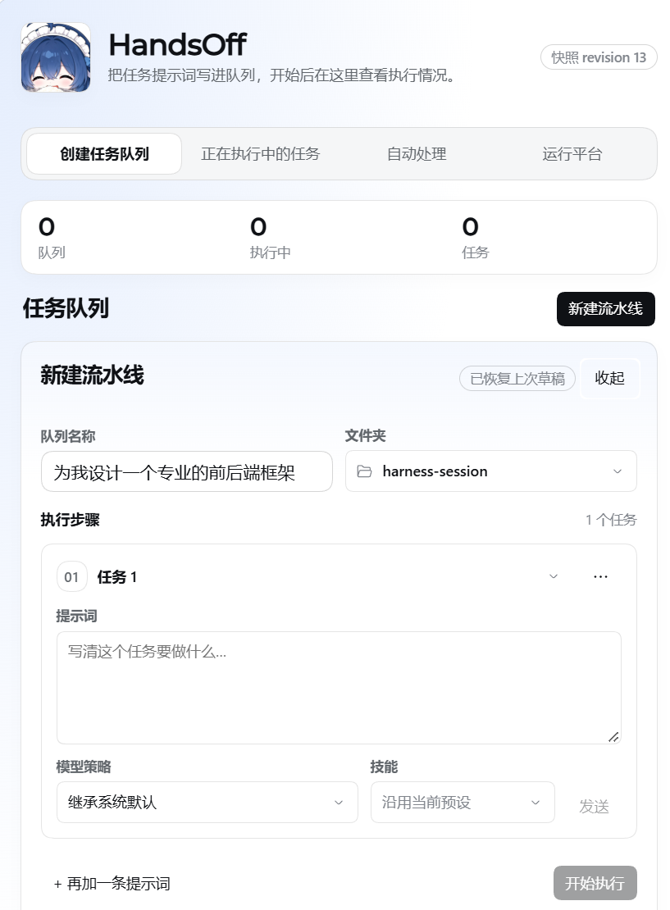
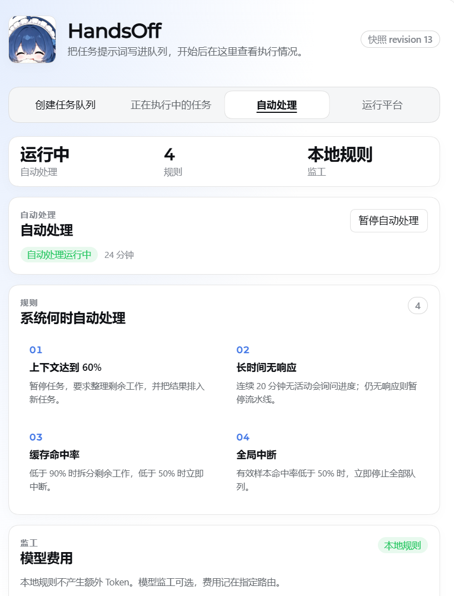

<div align="center">


# dsh-handsoff

[简体中文](README.md) | **English**

   

> Write the work up front as a task pipeline, hand it to AI: it queues, runs, watches and corrects itself — you just experience the result.

</div>

---

## What is this

**dsh-handsoff (plugin name HandsOff)** is a session orchestration plugin for [deepseek-harness](https://github.com/deepseek-ai/deepseek-harness) (dsh). It hands the "watching the AI work" part back to the AI:

- You agree on the **framework and task details up front** and write them as a task queue.
- The AI **orchestrates the project on its own**: tasks run in order, artifacts hand off across tasks.
- Built-in local rules **supervise every run**: high context pressure, long silence, abnormal cache hit rates — each is split, questioned or interrupted automatically.
- Humans do exactly one thing — **experience and feel the project**.

The plugin ships as two packages:

| Package | Path | Responsibility |
|---|---|---|
| `@deepseek-ai/dsh-session-orchestrator` | `packages/orchestrator/session-orchestrator` | Host side: durable task queues, run state machine, operations and handoff records, scheduler and supervisor |
| `@deepseek-ai/dsh-client-ui-settings-session-orchestrator` | `packages/client/ui-settings-session-orchestrator` | Client side: the "HandsOff" settings page — queues, board, automation, hosts |

## Why we built it

We want to **set ordinary programmers' hands free**.

In real projects the exhausting part is rarely writing code — it is supervising: checking whether the AI drifted, whether it will forget things as the context fills up, whether a stuck task should be retried. That work is mechanical, repetitive and draining, and it crowds out what a human should actually do: **decide what to build, then experience what was built**.

So we turned the supervisor into a plugin: stop staring at progress bars; agree on the framework and task details up front; let the AI orchestrate the schedule itself; and keep your energy for experiencing the result.

## What it does

- **Task queue**: create a pipeline with a name, a folder and an ordered list of prompts. Tasks run top-to-bottom, with an optional "run with previous item" for parallelism.
- **Four-stage template**: opt in via "More options" to generate Architecture → Breakdown → Implement → Test acceptance in one click; every stage prompt embeds your brief and reads the artifacts the previous stage left in `docs/pipeline`.
- **Parallel board**: every task under five fixed statuses (running / needs response / waiting / paused / ended), with one-click access to its conversation.
- **Automation (local rules, 0 tokens)**: context at 60% triggers a reorganization and re-queue; 20 minutes of silence triggers a progress question, then a pause; cache hit rate below 90% splits the remaining work, below 50% interrupts immediately; globally stop every queue when usable samples fall below 50%.
- **Supervision**: the default rule-based supervisor costs no tokens; an optional model-based supervisor bills its route and keeps a record of every inspection.
- **Revision fencing**: every write carries the revision it was loaded from (`expectedRevision`); conflicts are reported honestly and never overwrite your draft.
- **Hosts**: the DSH / WorkBuddy / Trae capability matrix is reported as-is — missing surfaces are shown as missing, never faked as success.

## Screenshots

**Create task queue** — write the prompts, press start:



**Automation** — four local rules watching every run:



## Install

The plugin targets **deepseek-harness 0.2.0-rc.2** (upstream moves fast — re-check the patch against newer versions).

### Option A: overlay into a harness source build (recommended today)

```bash
# 1. Get a matching upstream checkout
git clone https://github.com/deepseek-ai/deepseek-harness.git
cd deepseek-harness
git checkout <tag or commit for 0.2.0-rc.2>

# 2. Drop in the two plugin packages (keep the monorepo layout)
cp -r /path/to/dsh-handsoff/packages/orchestrator/session-orchestrator packages/orchestrator/
cp -r /path/to/dsh-handsoff/packages/client/ui-settings-session-orchestrator packages/client/

# 3. Apply the integration patch (registers the sessionOrchestrator Remote namespace and web-app composition)
git apply /path/to/dsh-handsoff/patches/harness-0.2.0-rc.2-integration.patch

# 4. Build
corepack enable
pnpm install
pnpm run build:web      # or pnpm run dev:web while iterating
```

> On Windows: copy the two folders with Explorer in step 2; if `git apply` fails in step 3, follow [docs/integration.md](docs/integration.md) to edit the 4 upstream files by hand — each change is small.

### Option B: `dsh plugin add` / plugin marketplace (planned)

Standalone packaging is on the roadmap (see [Outlook](#outlook)). Until then, use Option A.

## Usage

1. Start your dsh (local web build or desktop) and open **Settings → HandsOff**.
2. In the **Create task queue** tab, click "New pipeline": name it, pick a workspace folder, write the task prompts. Model strategy defaults to "inherit system default" and skills to "keep current preset"; each task may pin its own model.
3. Press **Start**. Tasks enter their own sessions in order and the AI gets to work.
4. Switch to the **Running tasks** board: five statuses at a glance, "Open conversation" on any row.
5. The **Automation** tab shows rule-triggered records and supervisor costs; pause or resume automation there.
6. The **Hosts** tab reports the runtime capability matrix (model catalog, skills, permission presets, compaction).

> Queues, tasks and supervision records live in the local `session_orchestrator` storage domain and back up with your session data.

## ⚠️ Experimental

This project is **experimental**:

- The automation rules are **not guaranteed to be accurate**: they may split or stop runs wrongly, or miss failure modes entirely.
- The four-stage template produces a runnable starting point, not an acceptance-free deliverable — keep a human check on the critical nodes.
- Try it in low-risk workspaces first; keep manual pause and retry as your safety net on important projects.
- Upstream harness iterates quickly; the newer the version, the more likely the patch conflicts.

## Outlook

- [ ] **Fully hand over projects to AI**: from requirements to delivery, no more energy spent on basic coding and pipeline babysitting.
- [ ] **Specs and skills**: a detailed, AI-native project production standard and skill pack, so programming novices can safely turn ideas into projects.
- [ ] **Standalone packaging**: a one-command `dsh plugin add` form, listed on the dsh plugin marketplace.
- [ ] **More hosts**: deepen the WorkBuddy and Trae adapter surfaces.
- [ ] **Configurable supervision**: expose the built-in thresholds (60% / 20 min / 90% / 50%) as settings.

## Repository layout

```
dsh-handsoff/
├── packages/
│   ├── orchestrator/session-orchestrator/          # host: queues, scheduler, supervisor, handoff
│   │   ├── src/                                    #   34 source files (pipeline/scheduler/pressure/warden…)
│   │   └── tests/                                  #   33 test files incl. fault injection & integration
│   └── client/ui-settings-session-orchestrator/    # client: the "HandsOff" settings page
│       ├── src/client/                             #   four tabs, section components, zh/en copy
│       └── tests/client/                           #   component & service tests
├── patches/
│   └── harness-0.2.0-rc.2-integration.patch        # integration diff against 4 upstream files
└── docs/
    ├── images/                                     # avatar & screenshots
    └── integration.md                              # manual integration guide
```

Tests run inside the harness workspace: after overlaying, run `pnpm run typecheck`, then run both packages' suites with the upstream vitest config.

## Contributing

Issues and PRs are welcome — rule tuning, host adapters and translations are good starting points. Please run `pnpm run typecheck` and the relevant tests before submitting.

## License

[MIT](LICENSE) © skyerd and dsh-handsoff contributors

Upstream [deepseek-harness](https://github.com/deepseek-ai/deepseek-harness) is also MIT-licensed, Copyright (c) 2026 DeepSeek. The avatar is the project's own plugin artwork (cropped) and is used only as the project identity.
